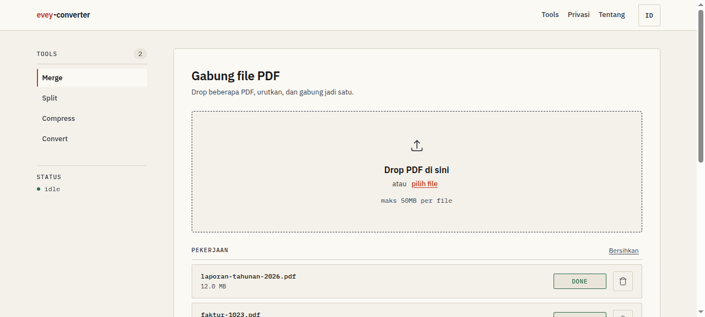

# evey-converter

PDF tools yang **tidak menyimpan file kamu**. Gabung, pisah, kompres, konversi,
dan lindungi PDF — semua diproses di server sendiri, bukan server pihak ketiga.
File input dan hasilnya **dihapus otomatis satu jam** setelah job selesai.



## Kenapa ada

Layanan PDF online (iLovePDF dan sejenisnya) mampir ke server orang lain: dokumen
sensitif — kontrak, laporan, data bisnis — berada di luar kendali kita, ada batas
ukuran file, dan tidak ada jaminan file dihapus. evey-converter menutup celah itu:
privasi adalah **alasan produk ini ada**, bukan fitur pelengkap.

- File diproses di mesin sendiri (2 vCPU, tanpa GPU).
- Input dan hasil dihapus permanen setelah **TTL 1 jam**.
- Tidak ada database untuk hasil — metadata job di SQLite lokal yang ikut terhapus.
- Batas upload 50 MB/file, 100 MB/job, maksimal 20 file per job.

## Fitur — 22 tool, 4 grup

**Organize**
`merge` · `split` · `organize` · `rotate` · `remove_pages` · `extract_pages`

**Optimize**
`compress` · `repair` · `pdfa`

**Convert**
`pdf_word` · `pdf_excel` · `pdf_ppt` · `word_pdf` · `excel_pdf` · `ppt_pdf` ·
`pdf_jpg` · `jpg_pdf` · `html_pdf` · `ocr`

**Security**
`protect` (kunci PDF dengan password) · `unlock` · `watermark`

## Stack

- **Backend:** FastAPI (Python) — job API + static frontend. Source backend
  tidak pernah bisa diakses lewat HTTP; hanya file frontend yang dilayani by-name.
- **Frontend:** HTML/CSS/JS vanilla (tanpa framework) — bilingual ID/EN.
- **Mesin PDF:** PyMuPDF, pikepdf, pdf2docx, pdfplumber, OCRmyPDF.
- **Queue:** pipeline dangkal (maks 2 job paralel), batas antrean 12, timeout per job 300 detik.
- **Rate limit:** sliding window per IP, key di-hash dengan salt yang dibuat saat
  first run (`secrets.token_bytes`), bukan alamat IP mentah.

## Cara menjalankan

```bash
python3 -m venv .venv && source .venv/bin/activate
pip install -r backend/requirements.txt
python -m backend.app          # atau: uvicorn backend.app.main:app --reload
# buka http://localhost:8000
```

Konfigurasi lewat environment variable (semua punya default aman, lihat
`backend/app/config.py`): `EVEY_WORK_DIR`, `EVEY_DB_PATH`, `EVEY_TTL_SECONDS`,
`EVEY_RATE_LIMIT_JOBS`, `EVEY_MAX_QUEUE`, `EVEY_MAX_PAGES`, dll.

## Tes

```bash
source .venv/bin/activate
python -m backend.tests.make_fixtures   # buat PDF contoh kecil
python -m backend.tests.test_api        # latih endpoint API
python -m backend.tests.exercise_tools  # latih tiap tool handler
python tools/doctor.py                  # cek dependensi & toolchain siap
```

## Struktur

- `backend/app/` — FastAPI app, registry tool, job manager, rate limit, config.
- `backend/app/ops/` — handler tiap tool, dikelompokkan: organize, optimize, convert, security.
- `backend/tests/` — fixture generator + latihan API + latihan tiap tool.
- `tools/` — `doctor.py` (cek toolchain) + setup script Windows.
- `PRD.md`, `PRODUCT.md` — kebutuhan produk dan posisi produk.

## Dokumentasi

- `PRD.md` — problem statement, user stories, success metrics.
- `PRODUCT.md` — positioning ("PDF tools yang nggak nyimpen file lu"), capability, brand.
- `.impeccable/surface-brief.md` — arah desain antarmuka (ink-on-paper shell).
